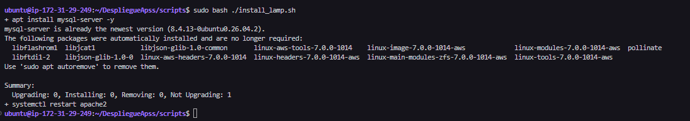
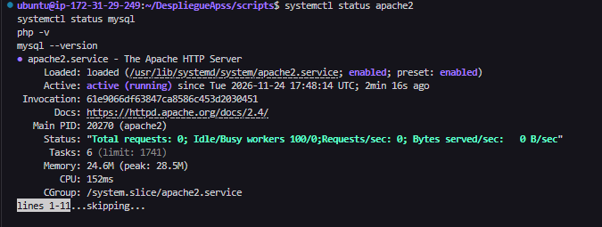

DespliegueApss

1. Descripción

En esta práctica se despliega una arquitectura web de un único servidor sobre una instancia EC2 de AWS con la última versión de Ubuntu Server. 

2. Estructura del repositorio
.
├── README.md
├── conf
│   └── 000-default.conf
├── htaccess
│   └── .htaccess
├── php
│   └── index.php
└── scripts
    ├── .env.example
    ├── install_lamp.sh
    └── install_tools.sh

El archivo .env real no se sube al repositorio (está en .gitignore). Se incluye .env.example como plantilla.

3. Creación de la instancia EC2
-Acceder a la consola de AWS y crear una instancia EC2.
-Seleccionar como AMI una Community AMI con la última versión de Ubuntu Server.
-Crear un par de claves (o usar vockey.pem de AWS Academy) para conectar por SSH.
-Configurar el grupo de seguridad con los siguientes puertos abiertos:
-Protocolo	Puerto	Uso
 -SSH (TCP)	22	Acceso remoto
 -HTTP (TCP)	80	Tráfico web
 -HTTPS (TCP)	443	Tráfico web seguro
Crear una dirección IP elástica y asociarla a la instancia.
Conectar por SSH:

ssh -i vockey.pem ubuntu@<IP_ELASTICA>

4. Instalación de la pila LAMP

La instalación se automatiza con el script scripts/install_lamp.sh:

Comprobaciones:

